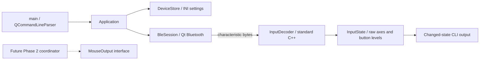
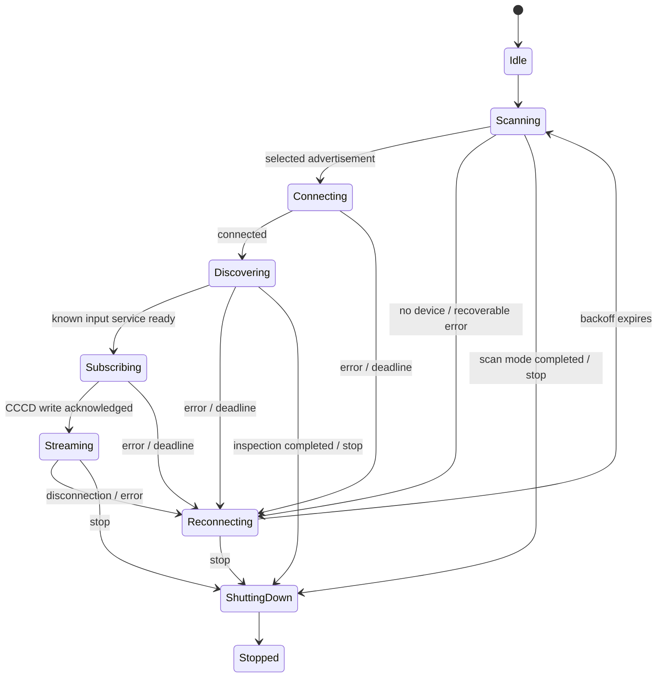

# Architecture

## Boundaries and ownership

The application uses one Qt event loop and no application-created worker threads. Native Bluetooth activity is asynchronous through Qt; OS console callbacks only set a flag. A timer transfers the stop request to the Qt thread.

`main` owns `QCoreApplication`, `DeviceStore`, and `Application` on the stack. `Application` owns `BleSession`, console handling, and its diagnostic timer by value, without assigning those value members a QObject parent. `BleSession` owns dynamically created discovery agents and controllers as QObject children. Service objects belong to their controller. QPointer members observe those children, and retired objects use `deleteLater()` to avoid deleting a signal sender inside its callback. QObject parent destruction provides the final cleanup fallback.

`src/core` and `src/protocol` have no Qt or Windows dependencies. The decoder consumes a read-only `std::span` and returns either a value or a specific validation error. It cannot connect devices or synthesize mouse events. `InputState` stores two unsigned, coarse raw axis values and two button levels; it does not assume a calibrated center or orientation.

`MouseOutput` is an interface for relative movement, button levels, and release-all. There is no implementation or instance in this version. Phase 2 must preserve holds and release native buttons on disconnect, invalid state, shutdown, and backend destruction.

## Lifecycle

Shutdown is accepted from every nonterminal state, including Idle, Connecting and Subscribing. Fatal errors also enter shutdown. The pure `Lifecycle` policy rejects repeated and invalid transitions; tests exercise normal, failure, and stop paths. One-shot scan/inspection failures exit with code 1 instead of retrying forever.

| Operation | Deadline/policy |
| --- | --- |
| Advertisement scan | 8-second scan, 12-second outer watchdog |
| Connect | 20 seconds |
| Service enumeration | 20 seconds |
| Each service's details | 15 seconds, sequential |
| CCCD subscription | 10 seconds; success requires matching descriptor and value |
| Retry | 1, 2, 4, 8, 16, 30 seconds, then capped at 30 |
| Retry reset | After 30 seconds streaming, provided at least one notification arrived |
| Input silence | Warn once after 15 seconds without a notification; rearm on new input |
| Shutdown disconnect | 2 seconds, then dispose local resources |

Silence is not proof of a failed link. There is no confirmed notification cadence or keep-alive, so silence alone does not force a disconnect. If the first input arrives after the 30-second stability window, it resets backoff at that point. An input received before the CCCD acknowledgment is buffered (latest value only) and forwarded only after subscription succeeds.

On failure, the session transitions to Reconnecting before retiring objects. Retirement increments a generation counter, cancels timers, disconnects signal handlers on scanner/controller, disposes the controller and its services, and clears pending operations. Every asynchronous callback checks its generation and relevant state. Only the single retry timer can start the next scan. Repeated failures do not enqueue additional attempts. Shutdown cancels that timer and cannot transition back to discovery.

## Device identity and GATT

Every attempt scans for fresh `QBluetoothDeviceInfo`; persisted addresses are preferences, not reconstructed controller objects. Identity is an address when available, otherwise a device UUID. Explicit selection is exact after canonicalization. Automatic discovery recognizes the advertised name `Pokemon PBP` or the input service UUID. Neither is an authentication mechanism.

The remembered identity wins when present. If absent, exactly one recognized candidate may replace it; the log makes that fallback visible. Ambiguity terminates with instructions to use `--device`. An explicit identity never falls back. Subscription success persists the selection; discovery alone does not.

Normal operation discovers only the known input service's details. Inspection visits every enumerated service sequentially. Both use `SkipValueDiscovery` to obtain metadata without automatic reads of unrelated proprietary values. Standard notification enablement is the only GATT write. Qt's [service API](https://doc.qt.io/qt-6/qlowenergyservice.html) documents these operations. Services and descriptors are recreated after each disconnect.

## Output and future platforms

The application forwards notifications only from the selected input characteristic. Invalid reports clear the last interpreted state; valid unchanged state is suppressed. Timestamp and motion-sensor bytes are excluded from `InputState`. Raw diagnostics show UTC timestamps, UUID, length and at most 512 bytes, with a ten-line-per-second cap. Suppression counts expose sampling; the mode is not a packet recorder.

Linux will need validation against Qt's BlueZ backend. Android will need a launch/package layer, Bluetooth runtime permissions and lifecycle handling; these are not implemented. Platform-specific code currently exists only for graceful console interruption. No claim of Linux or Android runtime support is made merely because the core is portable.
