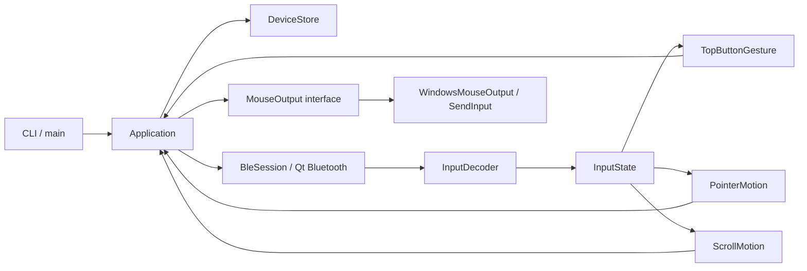
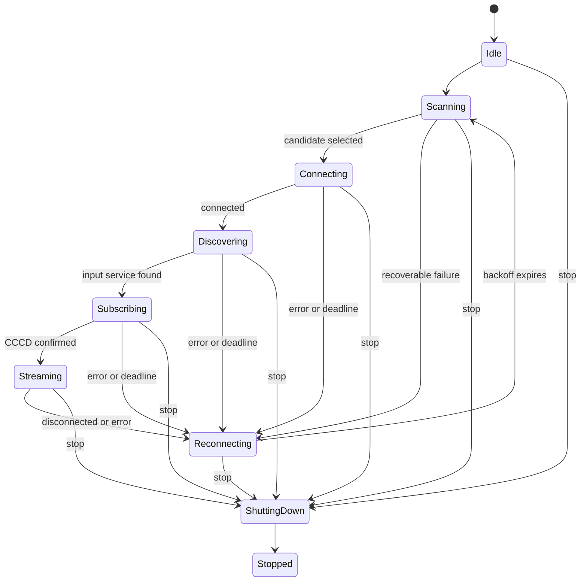

# Architecture

PokePointer v1.0.0 is a Qt 6 console application with a native Windows mouse backend. Bluetooth transport, input decoding, gesture recognition, pointer mapping, and OS mouse output are separate layers. The application uses one Qt event loop; it does not create a polling worker thread, driver, background service, or GUI.

## Data flow

The default CLI runs **diagnostics only**. The `--mouse` option creates `WindowsMouseOutput` and enables mouse effects; there is no mouse output without this option. `--scan`, `--inspect-gatt`, and `--debug-raw` provide discovery and input diagnostics.

## Components and ownership

| Component | Responsibility |
| --- | --- |
| `src/main.cpp` | Command-line options, Qt application lifetime, startup |
| `src/app/Application.*` | Coordinates BLE events, calibration, gestures, timers, mouse safety, output |
| `src/app/DeviceStore.*` | Remembers the selected device using a Qt settings file |
| `src/ble/BleSession.*` | Asynchronous scan, BLE connection, GATT discovery, notification subscription, retries |
| `src/protocol/InputDecoder.*` | Validates and decodes the known 17-byte input report |
| `src/core/InputState.h` | Coarse joystick coordinates and two button levels |
| `src/core/PointerMotion.h` | Calibrated relative motion and radial deadzone |
| `src/core/TopButtonGesture.h` | Short click, double-click, drag, double-tap-and-hold scroll detection |
| `src/core/ScrollMotion.h` | Joystick Y-axis to Windows wheel deltas |
| `src/platform/MouseOutput.h` | Platform-independent mouse-output contract |
| `src/platform/WindowsMouseOutput.*` | Native Win32 `SendInput` implementation |
| `src/platform/ConsoleStop.*` | Ctrl+C, Ctrl+Break, and Windows console-close requests |

`main` constructs the store and application coordinator. `Application` owns its BLE session, gesture and motion state, console handler, and Qt timers. `BleSession` creates Qt Bluetooth objects with QObject ownership and retires them when a connection attempt ends. BLE callbacks are guarded by a generation counter so obsolete asynchronous results cannot change the current session.

`src/core` and `src/protocol` do **not** depend on Qt or Windows APIs. Their mappings can be tested without a Bluetooth device. `InputDecoder` cannot generate mouse events; only `Application` passes validated effects to `MouseOutput`.

## BLE connection lifecycle

Each attempt performs a fresh advertisement scan and obtains new GATT objects. The input characteristic is subscribed to using the standard CCCD write (`01 00`); no proprietary initialization or keep-alive commands are used. Device selection prefers an explicitly provided identifier or a remembered identity. If a remembered identity is missing, only an unambiguous candidate can replace it. Multiple eligible candidates are not selected arbitrarily.

Important timing policies:

| Operation | Limit / behavior |
| --- | --- |
| Scan | 8-second BLE scan; 12-second watchdog |
| Connection | 20-second deadline |
| Service discovery | 20-second deadline; 15 seconds per service-details request |
| CCCD subscription | 10-second deadline |
| Retry | Backoff 1, 2, 4, 8, 16, then capped at 30 seconds |
| No input notifications | Warn after 15 seconds, without assuming the link disconnected |
| BLE shutdown | Up to 2 seconds before releasing local resources |

Successful subscription alone does not prove input notifications are arriving. See [protocol evidence](protocol.md) for the UUIDs, report fields, and limitations.

## Mouse processing and safety

After **12 stable, button-free input reports**, the joystick center is calibrated. `PointerMotion` applies a radial deadzone and nonlinear speed curve; it outputs relative X/Y movement. `TopButtonGesture` distinguishes a deferred short left click, a double click, holding the first press to drag, and holding the second press to scroll. During scroll, pointer movement is suppressed and `ScrollMotion` converts the Y axis into native wheel events. The joystick button independently controls the right mouse button.

One 16 ms timer drives motion and gesture deadlines only when required. A separate **500 ms input watchdog** resets calibration and releases all held mouse buttons if valid reports stop. Invalid reports and BLE input invalidation also clear mouse state. Held buttons are released when stopping or destroying the native output backend.

A Windows console handler requests a stop; the Qt event loop performs the mouse reset and BLE shutdown. For `CTRL_CLOSE_EVENT`, Windows allows a limited shutdown window, so the handler waits up to four seconds for Qt to finish. A forced process kill cannot guarantee a clean shutdown. These paths were tested with the physical controller, including closing a console window during a drag.

## Deployment and other platforms

The Windows release uses Qt Core, Qt Bluetooth, and `user32` for `SendInput`. A Release install packages `pokepointer.exe`, the two Qt DLLs, the versioned batch launcher, and documentation/license files. GitHub Actions runs the seven tests and builds the portable ZIP. See [Development and validation](development.md).

Linux and Android are not implemented targets in v1.0.0. Their future input-output backends and permissions must be validated separately; portability of the Qt-free core does not establish support for those systems.
